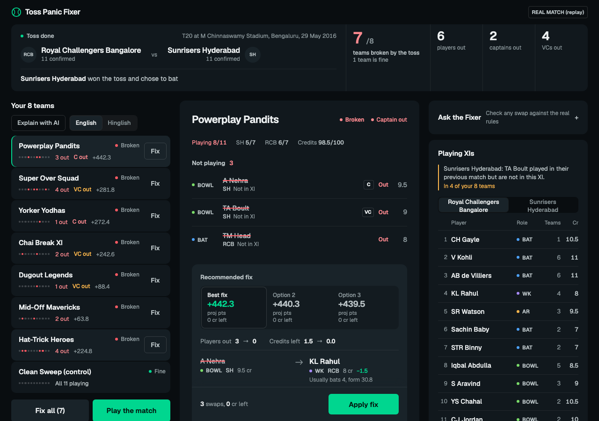
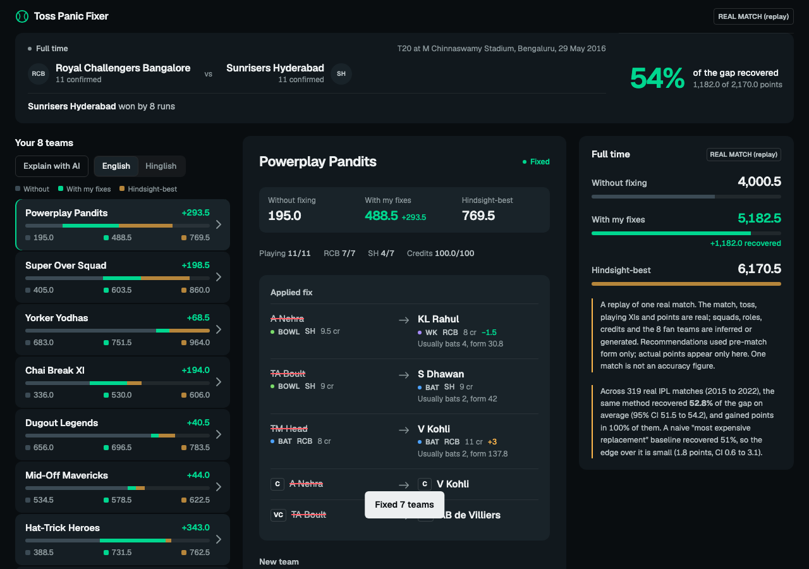

# Toss Panic Fixer

**Live demo: https://toss-panic-fixer-aadi.netlify.app**

After the toss, the playing XIs drop and fantasy cricket fans find out that some of their picks will not play. Toss Panic Fixer finds every broken team, ranks valid fixes under the real fantasy rules, keeps the captain and vice-captain when they are still playing, explains each fix in English or Hinglish, and then shows what the fixes were worth once the match is played.



## The fan problem

The toss happens minutes before lock. A fan with eight teams has to check 88 picks against two fresh XIs, work out which swaps still fit 11 players, 100 credits, at most 7 from one side and the role limits, and decide who captains now. A player who is not in the XI scores zero, and a captain who is out costs double. Doing that by hand under a deadline is the pain this tool removes.

## What it does

1. **Pre-toss:** your eight teams, all valid.
2. **Toss:** the XIs are announced. An impact summary shows teams broken, players out, captains and vice-captains out. Each team shows an availability line, and the ledger marks broken and fine teams.
3. **Repair:** pick a team to see who is out, the best fix and two alternatives, each swap as one row, credits left, and any captain or vice-captain change. Apply one fix or Fix all.
4. **Explain:** a two-sentence explanation per team, in English or Hinglish, from the model or from a deterministic template if the AI is unavailable.
5. **Ask the Fixer:** a question box where the model calls tools that run the real engine (team lookup, XI listing, an all-teams overview, swap simulation).
6. **Play the match:** results for doing nothing, your fixes, and the hindsight-best fix, plus the share of the gap recovered.

On a phone the same flow uses tabs, a team list with a one-tap Fix, and a bottom sheet for the repair.



## Real matches, and a simulated sample

The app opens on a **replay of a real IPL final** (REAL MATCH (replay) badge) built from [Cricsheet](https://cricsheet.org) ball-by-ball data (ODC-By licence). Four finals are bundled and a picker switches between them and the simulated sample. The sample uses fictional players and is labelled **SAMPLE (simulated)**; open it with `?match=sample`.

Real in a replay: the match, toss, playing XIs and the points. Inferred or generated: roles (from earlier matches), credits (approximated from form), the bench (regulars from the side's recent matches who are absent today), batting slots (typical slots from earlier matches) and the eight fantasy teams. These are listed inside the app under "How this replay was built".

**No hindsight leakage.** Form, roles, bench and credits use only matches dated before the target match. A test proves that changing the target match's deliveries changes nothing the fixer can see. Actual points appear only in the post-match view.

### Measured results

`npm run replay:eval` runs the fixer on every eligible real IPL match from 2015 to 2022, with three generated team sets each. Over **319 real matches** (921 runs):

| | Mean share of the gap recovered | 95% CI |
|---|---|---|
| This engine (pre-match form only) | **52.8%** | 51.5 to 54.2 |
| Naive "most expensive valid replacement" | 51.0% | 49.6 to 52.4 |

The engine gained points in every run, and beat the naive baseline in 56.7% of matches. The edge over the baseline is **small: 1.8 points (CI 0.6 to 3.1)**. Credits in the replays are approximated from form, so that baseline is strong by construction. Single matches vary a lot; the four bundled finals recover 37% to 56%. On the one simulated sample match the figure is 76%, which is one made-up match and not evidence of anything. Full output: [`data/replay/aggregate.json`](data/replay/aggregate.json).

## How it works

```
data/ (Cricsheet replays, simulated sample)
  -> src/engine.js      validate, find broken teams, enumerate and rank fixes (deterministic)
  -> src/evaluate.js    post-match comparison (only place actual points are used)
  -> src/app.js         UI: ledger | repair workspace | context rail (sheet on phones)
  -> netlify/functions  /api/explain and /api/ask call the Anthropic API server-side
```

### Where AI is used, and where code is used on purpose

| Job | Who does it | Why |
|---|---|---|
| Find broken teams, enumerate valid swaps, rank them, choose captain and vice-captain, score the result | Deterministic code (`src/engine.js`, `src/scoring.js`) | Fantasy rules are exact. A fix must be valid and reproducible, and a model must not decide validity. |
| Two-sentence explanation per team, English or Hinglish | Claude, given facts built by the engine on the server | Language is where a model helps. It may only use the facts it is given. |
| Answer free-form questions | Claude with tools that run the real engine | Answers come from engine results, not from the model's memory. |
| Fallback explanations | Template code (`src/explain.js`) | The app works with no AI. |

The model never ranks fixes and never sees match results. The server builds the facts itself; the browser sends only a language and a match id. Both endpoints validate input, have a 20 second timeout, a per-IP and a daily cap (in memory, so per warm function instance), and return a clean error that makes the UI fall back to templates.

Models: Claude Haiku 5.5 for explanations and Claude Sonnet 5.5 for Ask, overridable with `ANTHROPIC_MODEL_FAST` and `ANTHROPIC_MODEL_SMART`.

## Run it

```bash
npm install
npm test                       # 40 unit tests
npm run build                  # dist/index.html, a single static file
ANTHROPIC_API_KEY=... node scripts/dev.mjs   # http://localhost:8888, serves dist/ and /api/*
```

Without a key the app still works and shows the built-in explanations. Keep the key in an environment variable or `.env` (gitignored); on Netlify it is a secret environment variable.

Checks:

```bash
npm run e2e          # simulated sample, desktop and two phone widths (add the URL and --ai for a live site)
npm run e2e:replay   # real-match replays
npm run a11y         # axe-core in every state, plus keyboard and focus checks
```

To rebuild the replays, download `https://cricsheet.org/downloads/ipl_json.zip`, unzip it to `.cache/cricsheet-ipl/json`, then run `npm run replay:build` and `npm run replay:eval`.

## Limitations

- **Approximate scoring.** Points follow a Dream11-style T20 table written from public descriptions, not the official one. Every value is configurable in `src/scoring.js`.
- **Approximate credits and roles.** Dream11's credits are proprietary. Credits are derived from form and roles are inferred from earlier matches.
- **Form-only projections.** Projections use recent fantasy points and a batting-slot nudge. There is no pitch, opposition or fitness model.
- **Generated fantasy teams.** A real fan's teams would differ.
- **Limited data.** Only IPL matches with exactly 11 players listed per side (2015 to 2022) are used, to avoid impact-player leakage. 319 of 480 eligible matches could be evaluated; the rest lacked a valid team pool or history.
- **Not a live product.** There is no free live-lineup feed. The tool replays completed matches and one simulated sample.
- **Rate limit.** The cap is in memory per function instance, so it blunts casual abuse, not a determined attacker.
- **Browsers.** Tested in Chromium only.

## What I would build next with real lineup feeds

- Ingest announced XIs and toss events from a licensed feed so the fix runs minutes before lock, on the fan's actual teams.
- Use official credits and scoring rules, which would also make the measured figures directly comparable.
- Add pitch, opposition and role-specific projections, and evaluate them with the same no-leakage method.
- Offer the fix as a notification the moment the XI drops, with one-tap apply.

## Credits

Match data from [Cricsheet](https://cricsheet.org) (ODC-By).
